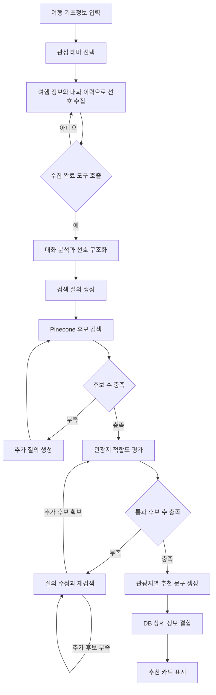

# FindSeoul


**여행 취향을 대화로 파악하고, 서울 관광지와 추천 이유를 제시하는 웹서비스입니다.**

서울 자유여행객이 정해진 선택지만으로 표현하기 어려운 취향을 대화로 구체화하는 데서 출발했습니다. 여행 기초정보와 관심 테마를 입력받고, 추가 대화에서 파악한 선호를 관광지 검색과 평가에 반영하도록 구성했습니다.

- **수행 기간:** 2025.04 ~ 2025.06
- **팀:** SeoulMate
- **출품:** 2025년 서울 열린데이터광장 공공데이터 활용 창업 경진대회 제출 후 미선정

## 담당 역할

팀 프로젝트로 진행했으며, 개인 담당 범위와 공동 작업은 다음과 같습니다.


| 구분        | 수행 내용                                                                                                                                          |
|---------------|--------------------------------------------------------------------------------------------------------------------------------------------------------|
| 본인 담당 | 아이디어 기획·구체화, 활용 데이터 선택, 선호 수집·추천 LLM 시스템, 웹 프론트엔드·백엔드 구현, 테스트·배포 |
| 팀원 담당 | 데이터 정제, 상세기획서 등 관련 문서 작성                                                                                             |
| 공동 작업 | 본인도 데이터 정제와 문서 작성에 참여하고 출품을 준비                                                                           |


역할과 제출 전 테스트·배포 이력은 프로젝트 수행 당시의 확인된 설명을 기준으로 합니다. 아래 구현 설명은 현재 저장소의 파일과 호출 관계를 정적으로 확인한 범위입니다.

## 현재 구현 범위


| 화면·기능               | 코드에서 확인되는 처리                                                                                                                                             | 주요 파일                                                                                                |
|------------------------------|------------------------------------------------------------------------------------------------------------------------------------------------------------------------------|--------------------------------------------------------------------------------------------------------------|
| 여행 기초정보 입력   | 본인 연령대, 동행자 관계·연령대, 여행 시작·종료일, 하루 방문 희망 수를 수집하고 입력값 검사                                           | [home_state.py](FindSeoul/homepage/home_state.py)                                                            |
| 관심 테마 선택         | 한류·전통문화·현대문화·쇼핑·야외·실내·문화체험 중 관심사를 선택해 여행 정보에 추가                                                  | [chatting_intro_state.py](FindSeoul/chatting_intro/chatting_intro_state.py)                                  |
| 선호 수집 대화         | 여행 정보와 대화 이력을 바탕으로 추가 질문을 생성하고, 완료 도구 호출에 따라 추천 단계로 전환                                         | [chat_state.py](FindSeoul/chatpage/chat_state.py), [chat_node.py](FindSeoul/chatpage/chatbot/chat_node.py)   |
| 관광지 추천             | 대화에서 선호를 구조화하고 검색 질의 생성·벡터 검색·적합도 평가·재검색·추천 문구 생성을 연결                                      | [recom_bot_node.py](FindSeoul/recopage/recommend_bot/recom_bot_node.py)                                      |
| 진행 과정·결과 표시 | 선호 분석, 검색 후보, 평가 결과를 단계별로 표시하고 최종 관광지 카드에 추천 이유·이미지·주소·상세 정보 및 지도 링크 표시 | [reco_state.py](FindSeoul/recopage/reco_state.py), [reco_component.py](FindSeoul/recopage/reco_component.py) |
| 언어 분기                | 한국어·영어 화면 문구, 대화·추천의 언어 입력, 검색 namespace 및 상세 정보 링크 분기                                                           | 각 화면의 `*_lang.py`, 대화·추천 상태와 노드                                                   |


홈 입력에서는 하루 방문 희망 수를 1~3개로 제한하고, `여행 일수 × 하루 방문 희망 수`가 9개를 넘으면 진행을 막습니다. 이 값은 입력 제한이며 최종 추천 개수를 보장하는 값은 아닙니다.

시간 단위 여행 플래너, 모바일 앱, 추가적인 추천 고도화는 기획서의 후속 계획입니다. 현재 공개 코드에서 연결된 주요 화면 흐름은 **여행 정보 입력 → 관심 테마 선택 → 선호 수집 대화 → 관광지 추천**까지이며, 완성된 일정 생성 기능으로 소개하지 않습니다.

## 대화와 추천 처리 흐름

화면 상태는 `HomeState → ChatIntro → ChatState → RecomState` 순서로 전달됩니다. 페이지 경로는 `/ → /chatting_intro → /chatting → /recommend`로 연결됩니다.



대화 흐름은 [chat_graph.py](FindSeoul/chatpage/chatbot/chat_graph.py), 추천의 노드 연결과 조건 분기는 [recom_bot_graph.py](FindSeoul/recopage/recommend_bot/recom_bot_graph.py)에 정의되어 있습니다. 위 도식은 정상 처리와 재검색 분기를 요약한 것입니다.

1. **선호 수집:** GPT-4o-mini가 여행 정보와 대화 이력을 받아 질문과 응답을 생성합니다. `conversaton_completed` 도구 호출이 발생하면 수집 완료로 분기합니다. 대화 그래프는 `thread_id`별 PostgreSQL 체크포인터를 사용하고, 마지막 상태의 메시지를 추천 화면에 전달합니다.
2. **대화 분석·질의 생성:** 추천 그래프는 도구 관련 메시지를 제외한 대화를 o3-mini로 분석해 관심 항목·관심도·판단 이유 등을 구조화합니다. 여행 정보와 분석 결과로 검색 질의를 생성합니다.
3. **후보 검색:** `text-embedding-3-small`과 Pinecone을 연결해 언어별 namespace에서 질의당 3개의 유사 후보를 요청합니다. 초기·추가 검색 결과는 관광지 ID를 기준으로 중복을 제거하며, 후보가 부족하면 추가 질의를 생성합니다.
4. **평가·재검색:** o3-mini가 후보별 적합도 점수와 이유를 생성합니다. 코드에서는 60점 이상을 통과 후보로 분류하고, 통과 후보가 부족하면 기존 질의와 통과·탈락 후보를 참고해 질의를 수정합니다. 재검색 후보를 확보하면 다시 평가합니다.
5. **최종 추천·상세 정보 연결:** 통과 후보에 대한 추천 문구를 생성한 뒤, 관광지 ID로 DB의 이미지 URL·주소·좌표·지도 및 상세 정보 링크를 결합합니다. DB 조회 결과와 ID가 일치하는 항목이 최종 결과에 포함됩니다.


검색·평가 단계의 후보 확보 목표는 `여행 일수 × 하루 방문 희망 수 × 2`입니다. 추천 그래프 호출에는 `recursion_limit=15`가 설정되어 있어 재검색을 무제한 수행하는 구조는 아닙니다. **적합도 점수와 선호 분석의 신뢰도는 LLM이 생성한 내부 판단값이며, 측정된 추천 정확도나 품질 지표가 아닙니다.**

추천 화면은 그래프의 비동기 상태 업데이트를 받아 진행 단계와 결과를 표시하도록 구현되어 있습니다. 대화 그래프의 PostgreSQL 체크포인트와 달리, 추천 그래프의 체크포인트는 `MemorySaver`를 사용합니다.

## 저장소 구조

```text
reco_seoul/  
├── FindSeoul/  
│   ├── FindSeoul.py          # Reflex 앱 생성과 페이지 모듈 연결  
│   ├── data_model.py        # 여행 정보·선호·질의·평가·추천 응답 모델  
│   ├── DB_connection.py     # SQLAlchemy 연결과 세션 구성  
│   ├── DB_model.py          # 관광지 상세 정보 테이블 모델  
│   ├── homepage/            # 홈 화면과 여행 기초정보 입력  
│   ├── chatting_intro/      # 안내와 관심 테마 선택  
│   ├── chatpage/  
│   │   └── chatbot/         # 선호 수집 그래프·노드·프롬프트  
│   ├── recopage/  
│   │   └── recommend_bot/   # 추천 그래프·노드·프롬프트  
│   ├── chaterrorpage/       # 대화 오류 안내 화면  
│   ├── recoerrorpage/       # 추천 오류 안내 화면  
│   └── coockie_manage/      # 세션 상태 확인 화면  
├── assets/                  # 기존 로고와 화면용 이미지  
├── rxconfig.py              # Reflex 설정  
├── pyproject.toml           # 프로젝트·의존성 선언  
└── requirements.txt         # 의존성 목록
```

각 주요 화면은 페이지 구성, 컴포넌트, 상태·이벤트, 스타일, 언어 문구를 나눈 구조입니다. [data_model.py](FindSeoul/data_model.py)의 Pydantic 모델은 여행 정보와 LLM 구조화 응답의 형태를 정의합니다.

## 기술과 데이터의 역할


| 기술                        | 코드에서의 역할                                                                                     |
|-------------------------------|------------------------------------------------------------------------------------------------------------|
| Python · Reflex              | 웹 화면, 페이지 전환, 상태 관리와 서버 측 비동기 이벤트 처리                       |
| LangChain · LangGraph        | 프롬프트·모델 연결, 구조화 응답, 대화·추천 상태 및 조건부 흐름 구성           |
| OpenAI 모델                 | GPT-4o-mini로 선호 수집 대화, o3-mini로 선호 분석·질의 생성·평가·추천 문구 생성 |
| OpenAI Embeddings · Pinecone | `text-embedding-3-small`을 통한 질의 임베딩과 관광지 후보 유사도 검색                   |
| PostgreSQL 체크포인터    | 대화 그래프의 메시지와 상태 저장                                                             |
| SQLAlchemy                    | 관광지 상세 정보 모델과 ID 기반 조회                                                         |
| Pydantic                      | 여행 정보와 선호·검색·평가·추천 결과의 데이터 구조 정의                          |


관광지 후보 검색과 상세 정보 조회는 별도 경로입니다. Pinecone 검색 문서의 ID·이름·분류·설명 등을 추천에 사용하고, [DB_model.py](FindSeoul/DB_model.py)의
`IdTable`에서 최종 표시용 상세 정보를 조회합니다.

 
